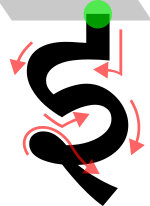

  

<h1 align="center">Stroke Learn</h1>

An app that helps you learn how to draw script-glyphs one stroke at a time. Currently, only supports Hindi (Devanagari). Can be extended to support any script (fictional or real).

---

---

## What it does
Learning a new language can be fun...if the script is familiar to you. This app is aimed at making the daunting task of learning a new script a bit more manageable. "Stroke Learn" teaches how to draw each character yourself, stroke by stroke, in the order it is actually written. Your attempt is compared against a reference tracing point by point, so the shape, the direction of each stroke and the number of strokes all count.

Three kinds of session: 
1. **training**, where the character sits faintly behind the canvas and each stroke is shown in grey to trace.
2. **test**, where you write from memory with only a box indicating where the character sits. 
3. **final exam** over everything, with no guides at all.
   
Characters you mark as learned drop out of future sessions, so the pool narrows to what you still find hard.

The Hindi set (default) ships with the app, including pronunciation audio and example words. Nothing in the app is specific to Devanagari — any script you can draw can be added.

## Install

Download the APK from [Releases](https://github.com/neuroady/stroke_learn/releases) and install it on your device.

### Pesky warnings
Android will warn you about installing an app from outside the Play Store, usually more than once. This is standard for any sideloaded app and says nothing about this one in particular — you will need to allow installation from whichever app you opened the file with, and dismiss a Play Protect prompt. Requires Android 8.0 or later.

Releases also include `hindi.json` (the character data on its own), if you want them separately. The character pronunciation data is located in `/app/src/main/assets/audio/hindi/` (follows CC 4.0)

## Building

Requires Android Studio (Ladybug or newer) and JDK 17. Clone the repository, open the project folder, let Gradle sync, and run.

- `minSdk` 26 (Android 8.0)
- `compileSdk` 36
- Kotlin with Jetpack Compose; no external services or API keys

Character data lives in `app/src/main/assets/scripts/` and audio in `app/src/main/assets/audio/<script>/`, named after each character's id.

## Making your own script

Scripts are plain JSON: a name, some groups, and for each character its glyph, romanisation and stroke data. You do not write that file by hand — the app's dataset mode walks through each character with the glyph shown faintly behind the canvas, you trace it, and the app exports the finished JSON.

To start, either add characters one at a time with the **+** button, or write a skeleton file listing every character with no strokes and load it through dataset mode. Then trace, export, and reload. Exported strokes are smoothed automatically, and a stylus gives noticeably better results than a fingertip.

Audio currently has to be bundled at build time: name each file after the character's id and drop it in the assets folder.

The full walkthrough ships inside the app, under **Notes → Making your own script**.

# Copyright

- App code itself follows GPL 3.0
- Data used to generate learning dataset follows from [CC BY 4.0](https://creativecommons.org/licenses/by/4.0/)
  - Stroke data (personal): CC BY 4.0
  - script files (personal): CC BY 4.0
  - [UT Austin audio (Hindi letters pronunciation)](https://hindi.la.utexas.edu/resources/pronouncing-the-hindi-alphabet/): already CC BY 4.0

# Acknowledgement
- Developed with substantial assistance from [Claude Opus (Anthropic)](https://www.anthropic.com/claude-opus-5-5).