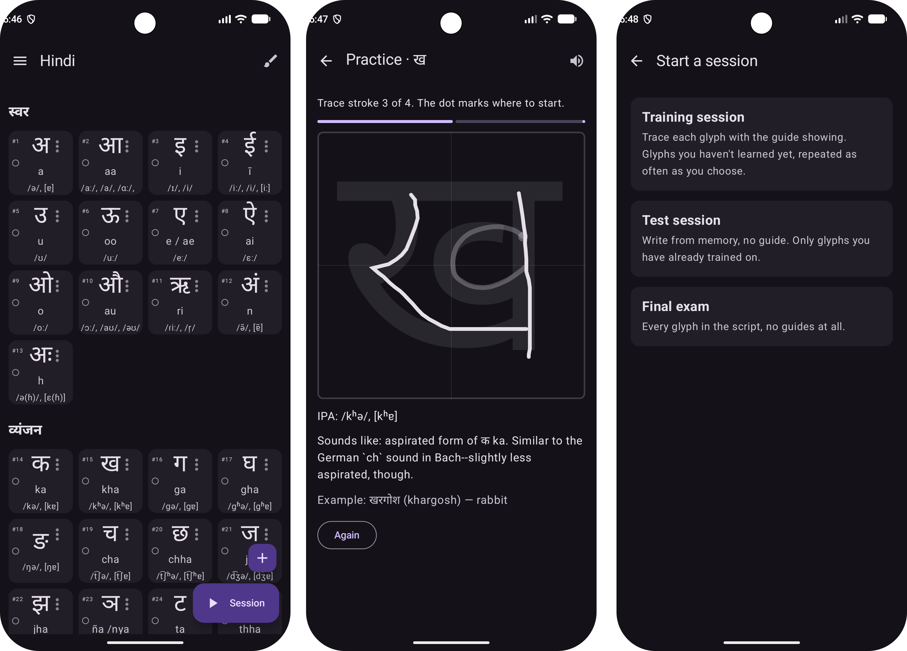

# stroke_learn

An app that helps you learn how to draw script glyphs one stroke at a time. Currently, only supports Hindi (Devanagri). Can be extended to support any script (fictional or real).
---

---

# Copyright
- App code itself follows GPL 3.0
- Data used to generate learning dataset follows from CC 4.0
    - Stroke data (personal): CC 4.0
    - [UT Austin audio (Hindi letters pronunciation)](https://hindi.la.utexas.edu/resources/pronouncing-the-hindi-alphabet/): already 4.0
